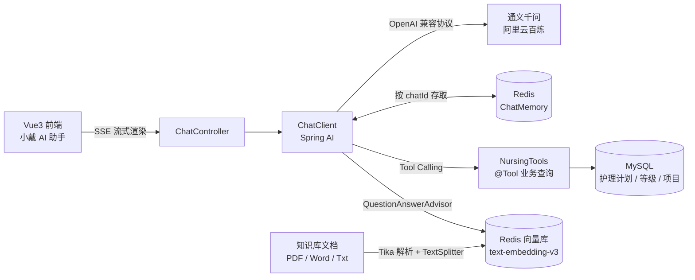

<div align="center">

# 养老智伴 · ElderMate

**面向中小型养老机构的智慧护理服务平台**

从「护理计划制定」到「AI 一句话查清价格」——把大模型接进养老院的日常业务流

[](#)
[](#)
[](#)
[](#)
[](#)
[](#)
[](#)
[](#)

[**核心功能**](#五核心功能)　·　[**技术栈**](#四技术栈)　·　[**项目结构**](#六项目结构)　·　[**快速开始**](#七快速开始)

<sub>Spring Boot 3.5 多模块 · Spring AI 1.1.2 · Vue 3.4 · MySQL 8 / Redis</sub>

</div>

---

## 30 秒读懂

| 维度 | 一句话 |
|---|---|
| **是什么** | 养老机构的护理业务管理后台，内置「小戴 AI 助手」 |
| **解决什么** | 护理计划 / 等级 / 项目的定价靠人工经验，数据分散、查询靠翻表 |
| **AI 怎么接** | 通义千问 + Spring AI：SSE 流式对话、Redis 多轮记忆、Tool Calling 直查业务库、RAG 知识库问答 |
| **技术底座** | Spring Boot 3.5 多模块（RuoYi 脚手架）+ Vue 3 + MySQL / Redis |
| **我的工作** | AI 对话链路、RAG 入库与检索、护理业务建模、机构资源管理、工程规范 |

> **设计主张**：「有哪些护理等级、价格多少、某个计划包含哪些护理项」这类问题，应该由 AI 直接查数据库回答，而不是让护理主管翻 Excel —— 答案要能落回业务表，而不是模型编造的漂亮话。

---

## 目录

- [一、项目背景（Situation）](#一项目背景situation)
- [二、项目目标（Task）](#二项目目标task)
- [三、我的工作与技术亮点（Action & Result）](#三我的工作与技术亮点action--result)
- [四、技术栈](#四技术栈)
- [五、核心功能](#五核心功能)
- [六、项目结构](#六项目结构)
- [七、快速开始](#七快速开始)
- [八、许可与致谢](#八许可与致谢)

---

## 一、项目背景（Situation）

随着老龄化加剧，养老院的护理计划制定、护理等级定价、护理项执行等核心业务高度依赖人工经验，信息分散且查询不便。同时，一线护理人员与管理人员缺乏一个能直接用自然语言获取业务数据的入口。

本项目面向中小型养老机构，提供护理计划 / 等级 / 项目的标准化管理，并在此基础上接入大模型，让 AI 助手能直接回答「有哪些护理等级、价格多少、某计划包含哪些护理项」等业务问题。

## 二、项目目标（Task）

1. 完成养老机构基础数据与护理业务数据的管理后台（楼层、房间、床位、护理项目、护理计划、护理等级）
2. 接入大模型对话能力，支持流式对话与对话历史记忆
3. 基于 RAG 实现知识库问答，支持文档上传 → 解析 → 切分 → 向量入库 → 检索增强
4. 通过 Tool Calling 让 AI 能直接查询业务数据库中的护理计划、等级、护理项等结构化数据

## 三、我的工作与技术亮点（Action & Result）

先看整条 AI 链路——一次提问，是怎么从浏览器流到数据库和向量库的：



### 1. AI 对话助手（Spring AI + DashScope）

- **流式对话**：基于 Spring AI 1.1.2 接入阿里云百炼（DashScope OpenAI 兼容模式）通义千问模型，使用 `Flux<String>` + SSE 实现打字机效果的流式输出
- **对话记忆**：基于 Redis 实现 `ChatMemory`，按 `chatId` 隔离多轮对话上下文，支持会话级历史保留
- **Tool Calling 工具调用**：封装 `@Tool` 工具方法，让大模型按需查询业务数据：
  - `WeatherTools`：天气查询（示例工具）
  - `NursingTools`：护理业务查询——列出护理计划、按计划查护理项明细、列出护理等级及价格、按等级查对应护理项

### 2. RAG 知识库问答

- **文档解析**：集成 `spring-ai-tika-document-reader`，支持 PDF / Word / Txt 文档内容提取
- **文本切分**：使用 `TextSplitter` 按配置的块大小与重叠切分长文档
- **向量入库**：基于 `spring-ai-redis-store` 写入 Redis 向量库，向量模型显式指定 `text-embedding-v3`
- **检索增强**：通过 `QuestionAnswerAdvisor` 在对话时自动检索相关文档片段注入上下文，回答有据可依
- **数据一致性**：删除知识库记录时联动清理 Redis 中对应的向量数据

### 3. 护理业务模块

基于 MyBatis / PageHelper 实现标准 CRUD，实体关系设计如下：

```
护理等级(NursingLevel) ──lplanId──▶ 护理计划(NursingPlan)
护理计划 ──(NursingProjectPlan 关联表)──▶ 护理项目(NursingProject)
```

- **护理项目**：原子护理服务项，含名称、单位、单价、护理要求
- **护理计划**：由多个护理项目组合，关联表记录执行时间、周期、频次
- **护理等级**：绑定护理计划，设置等级费用，形成「等级 → 计划 → 项目」的定价体系

### 4. 机构管理模块

楼层 → 房间类型 → 房间 → 床位 的四级机构资源管理，支持床位分配。

### 5. 工程规范

- 依赖版本统一在根 `pom.xml` 的 `<dependencyManagement>` 声明，子模块不写版本
- 敏感信息（API Key）通过 `local-secrets.yml` 本地私密文件注入，`.gitignore` 忽略，仓库仅保留环境变量占位
- 配置外置（Redis、OSS 等连接信息不放硬编码）

## 四、技术栈

| 层次 | 技术 |
|---|---|
| 后端框架 | Spring Boot 3.5.0 · Spring Security + JWT · MyBatis / PageHelper |
| AI 能力 | Spring AI 1.1.2（DashScope OpenAI 兼容模式）· Tika 文档解析 · Redis 向量库 |
| 数据存储 | MySQL 8 · Redis 7 |
| 前端 | Vue 3.4 + Vite 5 + Element Plus 2.4 + Pinia |
| 其他 | Quartz · springdoc-openapi（Swagger）· WebSocket · 阿里云 OSS |

## 五、核心功能

- **小戴 AI 对话助手**：SSE 流式对话、多轮记忆、Tool Calling 业务查询、RAG 知识库问答
- **护理管理**：护理项目、护理计划、护理等级的增删改查与关联维护
- **机构管理**：楼层、房间类型、房间、床位管理
- **知识库管理**：文档上传、RAG 入库、向量检索、记录删除联动清理向量
- **系统管理**：用户、角色、菜单、部门、字典、参数、操作日志、登录日志
- **基础设施**：定时任务（Quartz）、代码生成、缓存监控、服务监控

## 六、项目结构

```
ylzb
├── ylzb-admin             # Web 服务入口（启动模块，端口 8080）
├── ylzb-framework         # 框架核心：安全、拦截、数据源等配置
├── ylzb-system            # 系统模块：用户 / 角色 / 菜单 / 日志
├── ylzb-nursing-platform  # 养老护理业务模块（AI 对话 + RAG + 护理 + 机构）
├── ylzb-quartz            # 定时任务模块
├── ylzb-generator         # 代码生成模块
├── ylzb-common            # 公共模块：工具类、常量、异常
├── ylzb-oss               # 对象存储模块（阿里云 OSS）
├── ylzb_ui                # 前端工程（Vue 3）
└── sql                    # 数据库初始化脚本
```

## 七、快速开始

### 环境要求

- JDK 17+
- MySQL 8.x、Redis 6.x
- Node.js 18+（前端）

### 1. 后端

1. 创建数据库并导入 `sql/ylzb.sql`、`sql/quartz.sql`
2. 修改 `ylzb-admin/src/main/resources/application-dev.yml` 中的数据库与 Redis 地址
3. 配置 AI 访问密钥（二选一）：
   - 设置环境变量 `DASHSCOPE_API_KEY`
   - 或在 `ylzb-admin/src/main/resources/` 下新建 `local-secrets.yml`（已被 `.gitignore` 忽略，不会提交）：

     ```yaml
     spring:
       ai:
         openai:
           api-key: 你的百炼 API Key
     ```

4. 启动 `YlzbApplication`，或执行 `bin/run.bat`

### 2. 前端

```bash
cd ylzb_ui
npm install
npm run dev
```

浏览器访问 `http://localhost:80`（默认账号 admin / admin123）。

## 八、许可与致谢

- 本仓库沿用脚手架携带的 [LICENSE](LICENSE)（MIT · Copyright (c) 2018 RuoYi），仅用于学习交流
- 后端基于 [RuoYi](https://gitee.com/y_project/RuoYi-Vue)（MIT）二次开发，护理业务、机构管理与 AI 能力为新增部分
- AI 功能依赖 [阿里云百炼](https://bailian.console.aliyun.com/) 提供的模型服务，请自行申请 API Key 并注意密钥安全

---

<div align="center">
<sub>如果这个项目对你有帮助，欢迎点个 Star ⭐</sub>
</div>
